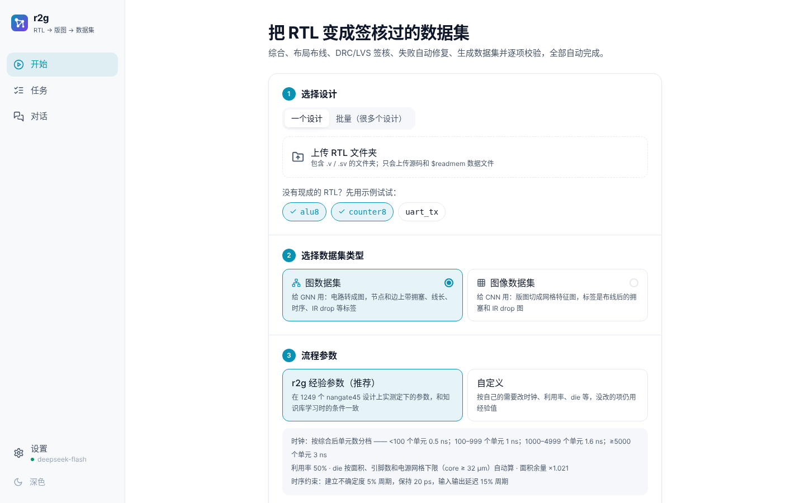
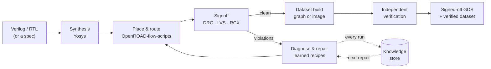
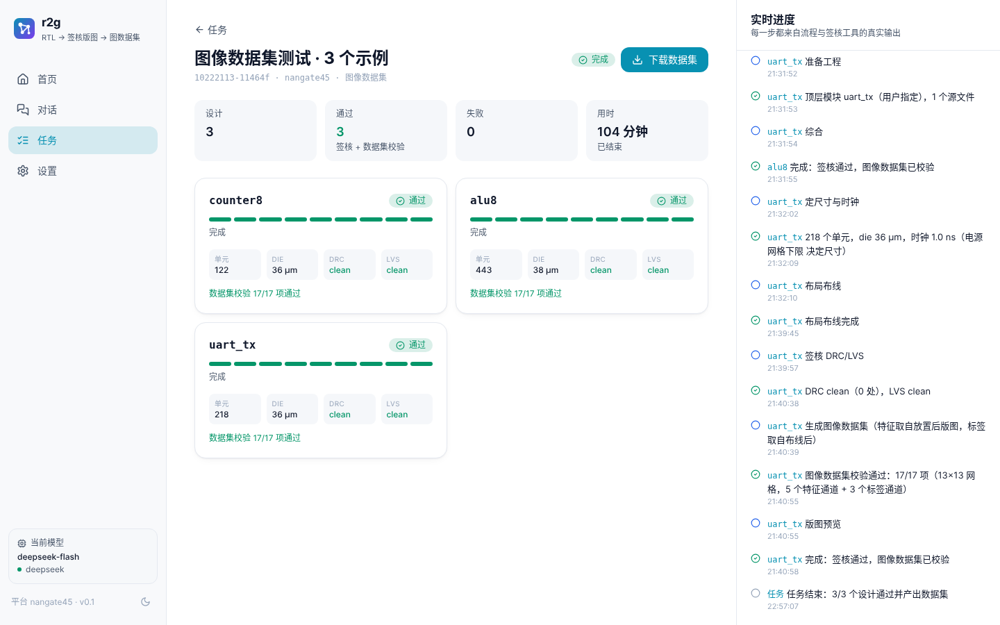
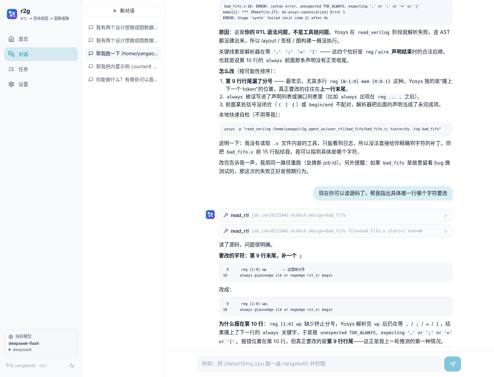
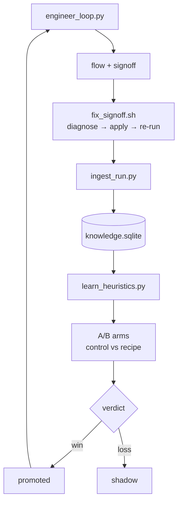

<div align="center">

# r2g

**From RTL to a signed-off layout, and on to a training-ready dataset.**

An open-source, autonomous EDA agent built on OpenROAD: synthesis, place-and-route, DRC/LVS signoff,
self-repair, and verified ML datasets from your Verilog.

[](LICENSE)


**English** · [简体中文](README.zh-CN.md)



</div>

---

## Contents

- [Highlights](#highlights)
- [How it works](#how-it-works)
- [Quick start](#quick-start)
- [Using r2g](#using-r2g)
- [Datasets](#datasets)
- [Why the results can be trusted](#why-the-results-can-be-trusted)
- [Claude Code skills](#claude-code-skills)
- [Platform support](#platform-support)
- [Validation](#validation)
- [Repository layout](#repository-layout)
- [Documentation](#documentation)
- [License](#license)

## Highlights

| | |
|---|---|
| **End to end** | Verilog in; synthesis, floorplan, placement, CTS, routing, GDS, DRC, LVS and RCX out, with no hand-holding. |
| **Self-repairing** | Reads its own logs, diagnoses failures, applies a learned repair recipe, re-runs and re-checks. Every run feeds a knowledge store that makes the next repair better. |
| **Datasets you can train on** | Signed-off designs become PyTorch Geometric **graph** datasets or GCell **image** datasets, each independently re-verified. |
| **Your choice of model** | DeepSeek, Qwen, Kimi, GLM, Doubao, OpenAI, Gemini, Claude, or a local Ollama model. Configure it once and it works. |
| **Three ways in** | A web app, a command line, or Claude Code / any MCP client. |

## How it works



The model decides *what to try*; code decides *whether it worked*. A design passes only when the DRC/LVS
checkers and the dataset verifier say so. No tool the model can call is able to declare a pass.

## Quick start

**Requirements:**
- an x86_64 Linux host with glibc ≥ 2.35 (Ubuntu 22.04+, Debian 12+, …); no root needed;
- Git, curl, CA certificates, and Python 3.10+ with `venv`/`ensurepip`;
- about 80 GB free for all three platforms and the self-test, including the 50 GB runtime disk guard;
- network access to GitHub, Conda and PyPI.

```bash
git clone https://github.com/ShenShan123/r2g-skills.git
cd r2g-skills
bash install.sh
```

The installer:
1. checks the machine;
2. installs the pinned toolchain, skipping anything already present:
   - prebuilt OpenROAD, Yosys and KLayout, the same builds that produced every r2g dataset, each sha256-checked;
   - pinned OpenROAD-flow-scripts;
   - the PyTorch environment for graph datasets;
   - SKY130/GF180 PDKs at the package versions the experiments used, hash-checked;
3. strictly validates nangate45, sky130hd and gf180;
4. installs the agent and puts `r2g` on `~/.local/bin`;
5. asks for a model and API key, which are stored locally only;
6. optionally runs a self-test: the built-in `counter8` from RTL to dataset on each selected platform.

A successful install does not mean an entire corpus will pass; the installer reports separately whether the
physical self-test ran.

<details>
<summary><b>Installer options</b></summary>

| Option | Effect |
|---|---|
| `--yes` | do not ask before each step |
| `--prefix DIR` | where the large files go |
| `--platforms nangate45` | install and validate only these platforms (comma-separated) |
| `--skip-toolchain` | the toolchain is already in place |
| `--provider deepseek --key-env DEEPSEEK_API_KEY` | configure the model non-interactively |
| `--no-config --selftest` | full-flow acceptance without any model key |

SystemVerilog repair uses a separate, experimental Yosys + Slang (OSS CAD Suite 2025-03-29). The installer
downloads it, verifies the archive and binary hashes, and records its path. It never replaces the Yosys used
by the place-and-route flow. Full help: `bash install.sh --help`.
</details>

## Using r2g

**Jobs run on the machine where r2g is installed; the browser is only a window onto them.** r2g installs on
Linux only, so on Windows or macOS install it on a Linux server and use your own computer's browser.

| Installed on | Jobs run on | Open the web app |
|---|---|---|
| Your Linux machine | that machine | `r2g ui`, then open `http://127.0.0.1:8770` |
| A server *(recommended)* | the server | keep `r2g ui` running there and forward the port (below) |

<details>
<summary><b>Running on a server</b></summary>

1. Start the service on the server and leave it running (tmux, or in the background):

   ```bash
   nohup r2g ui > ~/r2g_ui.log 2>&1 &      # default port 8770; change with: r2g ui --port 9000
   ```

2. Forward the port to your computer, either way:
   - **VS Code Remote:** forward `8770` in the *Ports* panel and click the globe icon.
   - **SSH tunnel** (same on Windows PowerShell, macOS and Linux):

     ```bash
     ssh -N -L 8888:127.0.0.1:8770 user@server
     ```

     A silent window after the password prompt is normal; keep it open and browse to
     `http://127.0.0.1:8888`. If you get `bind [127.0.0.1]:8888: Permission denied`, the local port is
     taken or reserved, so use another one (e.g. 7070). On Windows,
     `netsh interface ipv4 show excludedportrange protocol=tcp` lists reserved ports.

Notes:
- The service listens on the server's `127.0.0.1` only, so it is reachable just through SSH or VS Code forwarding.
- Closing the browser or the tunnel does not stop jobs. After a restart, unfinished designs resume
  automatically.
- Each user's jobs, settings, keys and repair knowledge live in their own `~/.r2g/`.
- *Settings → Compute* sets how many designs run at once and how many cores each gets. The web app, the CLI
  and chat share that limit.
</details>

### The web app

| Start | Jobs | Chat |
|---|---|---|
|  |  |  |
| Five steps: choose designs (one folder, or a batch with one subfolder per design, uploaded or given as a server path) → platform → dataset type → flow parameters (platform defaults, or your own clock, utilization, die) → start. No model needed. | Per-design progress (synthesis → place & route → signoff → repair → dataset → verification), failure reasons, repair history, layouts and logs, dataset downloads. Filter batches by state, group failures by cause, download finished parts while a batch runs. | Ask in plain language: *"find a small UART on GitHub and run it"*, *"run everything under /data/rtl at 2 ns"*, *"why did the failed designs in this job fail?"*. Needs a model configured in *Settings*. |

### Command line and other clients

```bash
r2g config --provider qwen --set-key     # switch model
r2g check-model                          # test connectivity and tool calling
r2g run --example counter8               # run directly, without chat
r2g status                               # list jobs
r2g chat                                 # chat in the terminal
r2g mcp                                  # serve as an MCP server for Claude Code, Cursor, …
```

## Datasets

| | Graph dataset | Image dataset |
|---|---|---|
| **Format** | PyTorch Geometric `HeteroData`: five views (b–f) plus the netlist graph | multi-channel GCell arrays (`.npz`, `[x][y]`) plus previews |
| **Features** | geometric and electrical features of cells, nets and pins | cell density, macro regions, RUDY, pin RUDY, pin density, **from the placed layout only** (no routing information) |
| **Labels** | congestion, wirelength, timing, IR drop, RC parasitics | congestion, IR drop |
| **Verification** | `tools/verify_graph_dataset.py`: hundreds of checks | `verify_images.py`: 17 checks, incl. per-cell agreement with the graph dataset's congestion labels |

The `def-graph` skill also builds **four-stage causal datasets** (floorplan, placement, CTS and route
snapshots of one design, as graphs or as images), each limited to what that stage could legally see. See
[`r2g-skills/def-graph/SKILL.md`](r2g-skills/def-graph/SKILL.md).

## Why the results can be trusted

- **The model judges; code decides.** Only DRC/LVS and the dataset verifier decide a pass. A crashed or
  timed-out checker is never a pass.
- **Only signed-off designs become data.** A signoff gate guards dataset construction. Layouts and reports are
  bound by content digest, so a changed layout invalidates its old reports.
- **Every dataset is recomputed independently.** The verifier shares no code with the generator. It re-parses
  DEF/LEF/SPEF itself and compares.
- **Failures are classified honestly.** The agent separates "your RTL is wrong" from "the tool or flow
  failed", and cites the real error codes.

Design document: [`docs/agent/AGENT_DESIGN.md`](docs/agent/AGENT_DESIGN.md).

## Claude Code skills

The engine under the agent ships as four [Claude Code](https://claude.com/claude-code) skills. You can use
them directly: ask Claude *"set up the EDA tools"*, then *"synthesize this UART at 100 MHz on nangate45"*.

| Skill | What it does |
|---|---|
| [`eda-install`](r2g-skills/eda-install/SKILL.md) | Detects the machine, then installs and verifies the toolchain (no-sudo path by default) |
| [`rtl-acquire`](r2g-skills/rtl-acquire/SKILL.md) | Discovers and screens RTL at corpus scale; synthesis-only netlist graphs; promotes candidates to full-flow projects |
| [`signoff-loop`](r2g-skills/signoff-loop/SKILL.md) | RTL → GDS with full signoff, plus the self-improving repair loop |
| [`def-graph`](r2g-skills/def-graph/SKILL.md) | Builds PyG graph and image datasets from signed-off DEF/LEF/SPEF |

```bash
bash r2g-skills/install.sh --user          # all four skills into ~/.claude/skills/
```

Then restart Claude Code or run `/reload`. Other modes: `--project .` (scoped to one project), `--link`
(symlink, so edits apply without reinstalling), `--force` (overwrite) and `--uninstall`.

<details>
<summary><b>Prerequisites</b></summary>

| Tool | Required | Purpose |
|------|----------|---------|
| Python 3.10+ | yes | skill scripts |
| Yosys | yes | synthesis |
| iverilog / vvp | yes | simulation |
| OpenROAD + ORFS | yes | place & route, RCX |
| Verilator | optional | faster lint |
| KLayout | optional | GDS viewer, DRC, LVS |
| Magic + Netgen | optional | sky130 DRC / LVS |
| OpenSTA | optional | standalone STA |
| sky130A PDK | optional | sky130 signoff |
| torch + torch_geometric + pandas | optional | PyG graph datasets (`run_graphs.sh`, `R2G_GRAPH_PYTHON`) |
</details>

<details>
<summary><b>Configuring the toolchain</b></summary>

The skills autodetect every tool on first use. Nothing needs to be sourced or exported if your tools are in
standard locations. The quickest route is to let `eda-install` detect and provision everything:

```bash
bash r2g-skills/bootstrap.sh --dry-run     # detect tools, PDK and torch venv; print a plan; install nothing
```

Without root it chooses a **no-sudo path**: prebuilt conda `litex-hub` binaries, plus a torch venv on a large
volume, never a full `$HOME`. Drop `--dry-run` to install the missing tiers and generate
`references/env.local.sh`; add `--prefix /big/volume` to choose where the PDK and venv go.

**Path A: a shared EDA server.** If `/opt/openroad_tools_env.sh` exists, it is sourced automatically.

**Path B: build ORFS from source** (about 30 min on 8 cores):

```bash
sudo apt install build-essential cmake git python3 python3-pip iverilog klayout tcl-dev libboost-dev flex bison
git clone --recursive https://github.com/The-OpenROAD-Project/OpenROAD-flow-scripts ~/OpenROAD-flow-scripts
cd ~/OpenROAD-flow-scripts && sudo ./etc/DependencyInstaller.sh && ./build_openroad.sh --local
echo 'export ORFS_ROOT="$HOME/OpenROAD-flow-scripts"' >> ~/.claude/skills/signoff-loop/references/env.local.sh
```

**Path C: OSS CAD Suite plus a separate OpenROAD binary:**

```bash
curl -LO https://github.com/YosysHQ/oss-cad-suite-build/releases/latest/download/oss-cad-suite-linux-x64.tgz
tar -xf oss-cad-suite-linux-x64.tgz -C "$HOME"
sudo apt install openroad
git clone --recursive https://github.com/The-OpenROAD-Project/OpenROAD-flow-scripts ~/OpenROAD-flow-scripts
```

Then set the paths in `env.local.sh`:

```bash
export ORFS_ROOT="$HOME/OpenROAD-flow-scripts"
export YOSYS_EXE="$HOME/oss-cad-suite/bin/yosys"
export IVERILOG_EXE="$HOME/oss-cad-suite/bin/iverilog"
export VVP_EXE="$HOME/oss-cad-suite/bin/vvp"
export VERILATOR_EXE="$HOME/oss-cad-suite/bin/verilator"
export OPENROAD_EXE="/usr/bin/openroad"
export KLAYOUT_CMD="/usr/bin/klayout"
```

**`env.local.sh`.** It lives at `~/.claude/skills/signoff-loop/references/env.local.sh`; copy it from
`env.local.sh.template`. Every key is optional; set only what autodetection gets wrong. To keep the file
anywhere else, export `R2G_ENV_FILE=/path/to/your-env.sh`.

| Variable | Checked in order (first hit wins) |
|----------|-----------------------------------|
| `ORFS_ROOT` | `$HOME/OpenROAD-flow-scripts`, `/opt/OpenROAD-flow-scripts`, `/opt/EDA4AI/OpenROAD-flow-scripts`, sibling of the skill dir |
| `OPENROAD_EXE` | `$ORFS_ROOT/tools/install/OpenROAD/bin/openroad`, `/usr/local/bin/openroad`, `/usr/bin/openroad` |
| `YOSYS_EXE` | `$ORFS_ROOT/tools/install/yosys/bin/yosys`, `/opt/pdk_klayout_openroad/oss-cad-suite/bin/yosys`, `/usr/local/bin/yosys`, `/usr/bin/yosys` |
| `IVERILOG_EXE` / `VVP_EXE` | `/opt/pdk_klayout_openroad/oss-cad-suite/bin/…`, `/usr/bin/…` |
| `KLAYOUT_CMD` | `/usr/local/bin/klayout`, `/usr/bin/klayout` |
| `MAGIC_EXE` | `/usr/local/bin/magic`, `/usr/bin/magic` |
| `NETGEN_EXE` | `netgen-lvs` or `netgen` on `$PATH`, `/usr/bin/netgen-lvs`, `/usr/local/bin/netgen` |
| `STA_EXE` | `sta` or `opensta` on `$PATH`, `/usr/local/bin/opensta`, `/usr/bin/opensta` |
| `PDK_ROOT` | `/opt/pdks`, `$HOME/pdks`, `/usr/local/share/pdks` |

**Signoff tools without sudo (Miniconda):**

```bash
curl -sL -o /tmp/miniconda.sh https://repo.anaconda.com/miniconda/Miniconda3-latest-Linux-x86_64.sh
bash /tmp/miniconda.sh -b -p "$HOME/miniconda3"
# --override-channels: the conda 'defaults' channel requires interactive ToS acceptance
"$HOME/miniconda3/bin/conda" create -y -n eda --override-channels -c litex-hub -c conda-forge magic netgen iverilog
"$HOME/miniconda3/bin/conda" install -y -n eda --override-channels -c litex-hub -c conda-forge open_pdks.sky130a  # ~8 GB
```

Then point `IVERILOG_EXE`, `VVP_EXE`, `MAGIC_EXE`, `NETGEN_EXE` and `PDK_ROOT` at
`$HOME/miniconda3/envs/eda/{bin,share/pdk}`. Avoid `volare` behind a SOCKS proxy: it needs `socksio`, and
unauthenticated GitHub listing is rate-limited.

**Verify the setup:**

```bash
bash ~/.claude/skills/signoff-loop/scripts/flow/check_env.sh
```

Every *required* line must read `ok` before a flow runs; optional `skip` lines are fine. nangate45 needs only
the required tools plus KLayout.

| Symptom | Fix |
|---------|-----|
| `MISS ORFS_ROOT` | set `ORFS_ROOT` in `env.local.sh` |
| `MISS OPENROAD_EXE` / `MISS YOSYS_EXE` | set the path, or run `build_openroad.sh --local` first |
| `MISS IVERILOG_EXE` | `sudo apt install iverilog`, or set `IVERILOG_EXE` |
| Platform list empty | `ORFS_ROOT` is set but `flow/platforms/` is missing; check the ORFS clone |
</details>

<details>
<summary><b>Using the scripts without Claude Code</b></summary>

```bash
SKILL=~/.claude/skills/signoff-loop
PROJ=design_cases/my_counter

python3 $SKILL/scripts/project/init_project.py my_counter          # scaffold
cp my_counter.v $PROJ/rtl/design.v; cp tb_counter.v $PROJ/tb/testbench.v
cp $SKILL/assets/config-template.mk $PROJ/constraints/config.mk
cp $SKILL/assets/constraint-template.sdc $PROJ/constraints/constraint.sdc   # edit DESIGN_NAME, VERILOG_FILES, clock port

bash $SKILL/scripts/flow/run_lint.sh  $PROJ/rtl/design.v $PROJ/lint/lint.log            # frontend
bash $SKILL/scripts/flow/run_sim.sh   $PROJ/rtl/design.v $PROJ/tb/testbench.v $PROJ/sim
bash $SKILL/scripts/flow/run_synth.sh $PROJ/rtl/design.v my_counter $PROJ/synth

bash $SKILL/scripts/flow/run_orfs.sh $PROJ nangate45                                    # place & route → GDS

python3 $SKILL/scripts/extract/extract_ppa.py  $PROJ $PROJ/reports/ppa.json            # timing gate
python3 $SKILL/scripts/reports/check_timing.py $PROJ
python3 $SKILL/scripts/reports/fmax_search.py  $PROJ nangate45                          # optional Fmax search

bash $SKILL/scripts/flow/run_drc.sh $PROJ nangate45                                     # signoff
bash $SKILL/scripts/flow/run_lvs.sh $PROJ nangate45
bash $SKILL/scripts/flow/run_rcx.sh $PROJ nangate45

R2G_GRAPH_PYTHON=/path/to/venv/bin/python \
bash ~/.claude/skills/def-graph/scripts/flow/run_graphs.sh $PROJ nangate45              # dataset
# -> dataset/{b..f}_graph.pt (HeteroData; R2G_GRAPH_KIND=homo|both), netlist_graph.pt, graph_manifest.json
```

A worked example is in `r2g-skills/signoff-loop/assets/examples/simple-arbiter/`.

| Stage | Script | Output |
|-------|--------|--------|
| Normalize / init | `scripts/project/{normalize_spec,init_project}.py` | `input/normalized-spec.yaml`, project scaffold |
| Lint / sim / synth | `scripts/flow/run_{lint,sim,synth}.sh` | `lint/` `sim/` `synth/` |
| Place & route | `scripts/flow/run_orfs.sh` | `backend/RUN_*/results/6_final.{gds,odb}` |
| Route abort check | `scripts/extract/extract_route.py` | `reports/route.json` |
| Signoff | `scripts/flow/run_{drc,lvs,rcx}.sh` | `reports/{drc,lvs,rcx}.json` |
| PPA / timing gate | `extract_ppa.py`, `check_timing.py` | `reports/ppa.json`; pass / minor-fix / escalate |
| Signoff repair | `scripts/flow/fix_signoff.sh` | `reports/fix_log.jsonl` |
| Labels / features / graphs | `def-graph/scripts/flow/run_{labels,features,graphs}.sh` | `labels/`, `features/`, `dataset/` |

Every signoff checker runs under a bounded process-group supervisor (`_bounded_run.sh`), so a hung tool can't
outlive its script. Each stage's artefacts are recorded by digest, so a resumed run reuses only stages whose
bytes match their recorded parent. The dataset signoff gate re-verifies that chain before it publishes.
</details>

<details>
<summary><b>Batch mode</b></summary>

`tools/` drives the skills across hundreds of designs in parallel. It is not installed with the skills;
clone the repository to use it.

```bash
python3 tools/setup_rtl_designs.py                       # scaffold design_cases/ from an RTL catalog
bash tools/batch_orfs_only.sh 8 7200                     # ORFS on every project: 8-way, 2 h per-stage timeout
python3 tools/fix_orfs_failures.py                       # classify failures and rewrite config.mk
DESIGNS_LIST=failed.txt bash tools/batch_orfs_only.sh 8 7200   # retry
```

`fix_orfs_failures.py` handles six failure patterns:
- wrong top module;
- `SYNTH_MEMORY_MAX_BITS` overflow;
- IO pin overflow;
- place-density overflow;
- PDN strap width;
- stage timeout.

Its structural gate fingerprints a design and rejects RTL edits that hollow it out. The exit code is the
verdict: 0 = preserved, 2 = reject, 3 = flag, 1 = error.
</details>

<details>
<summary><b>The closed learning loop</b></summary>

Every run teaches the skill. There are two memory databases with distinct roles:

| Database | Role | In git |
|---|---|---|
| `knowledge/knowledge.sqlite` | what *resulted*: runs, failure events, violations, fix trajectories, symptoms, lessons, A/B trials, recipe status | **yes**, shipped pre-trained |
| `knowledge/journal.sqlite` | what was *done* and why: every action, log summary and tool bug | no; local forensics, read by no learner |

`scripts/loop/engineer_loop.py` drives the whole cycle unattended: flow → signoff repair → ingest → learn →
A/B trial → promote or demote → escalate unknowns. A recipe moves `shadow → candidate → promoted` only on a
variance-aware A/B win over *k* repeats, and an inconclusive verdict never demotes. Repair experience is keyed
by symptom signature, not by platform, so a fix learned on nangate45 can transfer to sky130hd.



Details: [`signoff-loop/knowledge/README.md`](r2g-skills/signoff-loop/knowledge/README.md) and
[`references/engineer-loop.md`](r2g-skills/signoff-loop/references/engineer-loop.md).
</details>

## Platform support

| Platform | KLayout DRC | KLayout LVS | Magic DRC | Netgen LVS | OpenRCX | Agent / web app |
|---|:---:|:---:|:---:|:---:|:---:|:---:|
| `nangate45` | ✓ | ✓ | — | — | ✓ | ✓ |
| `sky130hd` | ✓ | ✓ | ✓ | ✓ | ✓ | ✓ |
| `sky130hs` | ✓ | ✓ | ✓ | ✓ | ✓ | — |
| `gf180` | ✓ | ✓ | — | — | ✓ | ✓ |
| `ihp-sg13g2` | ✓ | ✓ | — | — | ✓ | — |

- **SKY130.** Netgen LVS is the production path; antenna-diode designs and port-to-port feedthroughs are
  handled automatically or with a stage hook.
- **Platforms without LVS rules.** LVS reports `skipped` rather than failing.
- **ASAP7** is not supported by the default flow (`run_orfs.sh` refuses it): no open deck can reach a clean
  verdict. A separate qualification with the official Calibre decks is documented in
  [`experiments/asap7_qualification_20261116/`](experiments/asap7_qualification_20261116/REPORT.md).

## Validation

- **Tests:** 2,725 collected across the four skills (as of 2026-11-20): signoff-loop 1,624, def-graph 669,
  rtl-acquire 367, eda-install 65. They include synthetic corner cases that drive the real extractors and
  check all five graph views against hand-derived ground truth. Every verifier check is proven to fail on a
  deliberate corruption.
- **nangate45 corpus (682 designs, 2026-06):**
  - ORFS place & route: 476 of 495 designs from the original batch.
  - LVS: 607 of 674 clean (90%); most of the rest are known tool limits, not layout errors.
  - DRC: honest verdicts on 675 of 682.
  - RCX: 681 of 682.
  - A curated 70-design subset passes 100%.
- **sky130hd campaign (2026-06):**
  - 174 of the first 176 designs fully signed off.
  - `route_relief` cleared 18 of 25 route-congestion failures.

## Repository layout

```
r2g-skills/
├── install.sh            # one-command installer for the agent and toolchain
├── agent/                # the r2g agent: CLI, web server, MCP server, model adapters
├── webui/                # web app source (built into agent/r2g_agent/web/dist)
├── r2g-skills/           # the four Claude Code skills (installed into ~/.claude/skills/)
│   ├── eda-install/      #   detect → install → verify the toolchain
│   ├── rtl-acquire/      #   corpus-scale RTL acquisition, synthesis-only netlist graphs
│   ├── signoff-loop/     #   RTL → GDS, signoff, the repair loop and knowledge store
│   └── def-graph/        #   graph and image datasets from signed-off layouts
├── tools/                # batch orchestration and the independent dataset verifier
├── experiments/          # experiment runners, protocols and evidence for the paper
├── docs/                 # agent design notes and screenshots
└── tests/                # repository-level tests
```

## Documentation

| Topic | Where |
|---|---|
| Agent design | [`docs/agent/AGENT_DESIGN.md`](docs/agent/AGENT_DESIGN.md) |
| Flow, signoff and repair | [`r2g-skills/signoff-loop/SKILL.md`](r2g-skills/signoff-loop/SKILL.md) |
| Known failures and fixes | [`signoff-loop/references/failure-patterns.md`](r2g-skills/signoff-loop/references/failure-patterns.md) |
| What each platform checks | [`signoff-loop/references/signoff-contract.md`](r2g-skills/signoff-loop/references/signoff-contract.md) |
| Datasets: views, tensors, labels | [`def-graph/references/graph-dataset.md`](r2g-skills/def-graph/references/graph-dataset.md) |
| Four-stage datasets | [`def-graph/references/four-stage-dataset.md`](r2g-skills/def-graph/references/four-stage-dataset.md) |
| Changes | [`CHANGELOG.md`](CHANGELOG.md) |

## License

[MIT](LICENSE) © 2026 Shenshan
