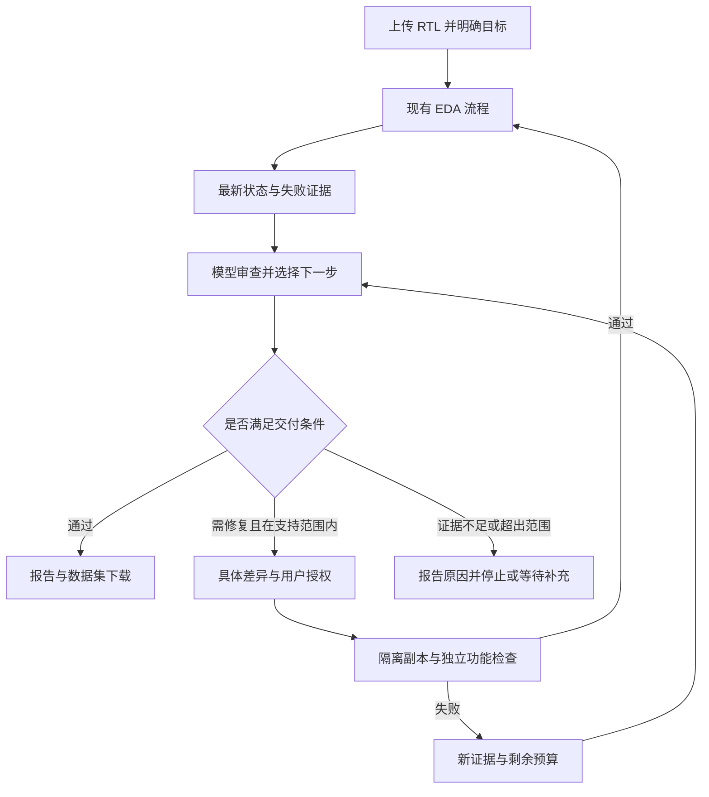

# EDACode

**从 RTL 到签核、数据集和可检查交付的 EDA 工程 Agent。**

EDACode 以网页为主要入口，在 r2g 的既有 EDA 流程上增加任务上下文、模型决策、持久执行记录和受控修复。用户上传 RTL、描述目标后，可以在同一会话中查看进度、审核修复差异，并获取最终报告与数据集。

模型读取最新证据，选择下一步；r2g 流水线执行综合、布局布线、签核和数据集生成；检查器决定是否通过。TEHM 提供有适用条件和来源的经验咨询。CLI 保留为调试与自动化入口，命令名仍为 `r2g`。

## 现在能做什么

| 能力 | 当前行为 |
| --- | --- |
| RTL 到数据集 | 上传单个设计或一批设计，运行综合、布局布线、DRC/LVS、RCX，生成并校验图或图像数据集 |
| 对话中的任务进度 | 展示公开操作说明、工具结果和阶段状态；成功、失败或确认取消后收起过程，保留结果、原因和下载入口 |
| 按任务组织上下文 | 保留原始历史，为模型选择近期完整工具组、带来源的历史索引、用户要求、未决动作和最新作业状态 |
| 后台结果审查 | 与会话关联的作业结束后，自动创建去重的只读审查回合，依据新报告交付或提出下一步 |
| 有限修复 | 先生成差异，用户批准后在新副本中执行，先做独立功能检查，再进入完整 EDA 流程 |
| 中断与恢复 | 持久记录回合、动作、提交身份和流式事件；能确认状态的任务按既有规则恢复，不确定的副作用停止重放 |
| 经验咨询 | 默认复用 TEHM，返回候选动作的适用条件、来源、绑定和拒绝原因；缺少证据时明确弃权 |
| 结果交付 | 下载数据集、报告和文件哈希清单；已验证的受控修复还包含补丁、功能检查和执行输入绑定 |

## 快速开始

### 完整安装

安装面向 x86_64 Linux，需要 Python 3.10+、`venv`、Git，以及下载工具链所需的网络。浏览器可以运行在 Windows、macOS 或 Linux，EDA 任务在安装 EDACode 的 Linux 机器上执行。

```bash
git clone --branch EDACode --single-branch https://github.com/ShenShan123/r2g-skills.git EDACode
cd EDACode
bash install.sh
r2g ui --port 8770
```

浏览器打开 **http://127.0.0.1:8770**。安装器会检测并安装或复用 EDA 工具链，验证 nangate45，安装 Python Agent 与已构建的网页，并提供模型配置和可选自检。若 `r2g` 尚未加入 PATH，可使用 `~/.local/bin/r2g`。

工具链与运行产物都需要磁盘空间；运行时默认空闲磁盘门槛为 **50 GB**，批量设计需另行预留工作目录空间。安装耗时取决于网络和已有工具，完整参数见 `bash install.sh --help`。

已有完整工具链时可跳过下载，仍会检查平台是否就绪：

```bash
bash install.sh --skip-toolchain
```

### 从源码运行

已有 EDA 环境、希望直接使用仓库代码时，在仓库根目录执行：

```bash
python3 -m venv .venv
.venv/bin/python -m pip install -e ./agent
PYTHONPATH=agent:memory .venv/bin/python -m r2g_agent.cli ui --port 8770
```

已有 `.venv` 时复用即可。源码运行不会替代 EDA 工具链安装；网页构建产物已随源码提供，启动服务无需先安装 Node.js。

### 在远程服务器上打开网页

在服务器启动服务并保持进程运行：

```bash
r2g ui --port 8770
```

在自己的电脑建立 SSH 隧道：

```bash
ssh -N -L 8889:127.0.0.1:8770 用户名@服务器地址
```

随后打开 **http://127.0.0.1:8889**。也可以使用 VS Code 的端口转发。长时间运行建议把服务放在 tmux 中。

服务默认只监听 `127.0.0.1`。若服务器提示 `address already in use`，先确认是否已有 EDACode 服务；需要另开实例时换端口，例如 `--port 8771`，并将隧道右侧端口同步改为 `8771`。本机转发端口被占用时，只需更换左侧的 `8889`。

## 网页工作流

- **开始**：上传设计或选择内置示例，确定 graph / image、平台与流程参数后提交；直接运行 EDA 不要求配置模型。
- **任务**：查看每个设计的阶段状态、签核结果、日志、版图和下载；支持批量筛选与取消，取消完成以实际状态为准。
- **对话**：上传 RTL 并说明目标，模型调用工具、解释证据、提出受控修复；需要先配置支持工具调用的模型。

例如，在对话中上传 RTL 后输入：

> 为这个设计生成 graph 数据集，时钟周期 1 ns。保留原始 RTL 和接口；如果失败，先解释原因并给出可审核的修复差异。



与聊天会话关联的作业完成或失败后，任务事件桥会发起一次持久的结果审查，不需要用户不断追问进度。只读审查可以读取证据或提出修复提案，不能自行启动、修改或取消作业。若模型服务不可用，审查错误会保留，已有 EDA 结果不因此失效。

界面展示的是操作说明、工具反馈和实际阶段记录。任务结束后这些内容自动折叠，仍可手动展开；最终结果和失败原因保留在外部。模型隐藏推理不作为页面或执行接口。


## 上下文、持久执行与恢复

**原始会话保留，模型读取的是按任务组织的视图。** `ContextBuilder` 每轮组合当前目标、保护的用户要求、未决动作、批准记录、最新 JobContext、近期完整工具组和较早历史的来源索引。旧记录和工具大输出可以按需读取；旧作业失败保留为历史证据，不作为新作业的当前故障。

默认 `context_max_chars=64000`、`context_recent_turns=3`。这是本地字符预算与近期回合策略，不是精确的供应商 token 窗口估算；必要约束或工具配对无法安全保留时，会停止模型调用。

执行记录连接 session、turn、action 和 job：

- 请求与任务提交使用幂等身份，同一身份改变输入会冲突；同一会话的活动回合按持久状态控制。
- 工具先登记动作意图，再执行，最后保存真实结果；任务提交后尚未写回聊天的窗口通过持久记录核对。
- 流式事件先保存，网页按回合和事件位置续读；关闭浏览器不等于取消后台任务。
- 服务重启后先核对旧进程与执行记录。能确认安全的 EDA 任务可恢复；无法确认的执行标为 `recovery_required`，不直接重放模型调用或工具副作用。


## 模型配置

命令名沿用 `r2g`。可在网页设置服务商、模型与密钥，也可使用 CLI。此次真实验收使用 DeepSeek Flash：

```bash
r2g config --provider deepseek --model deepseek-flash --set-key
r2g check-model
```

`--set-key` 通过不回显的输入读取密钥。若使用已导出的环境变量：

```bash
r2g config --provider deepseek --model deepseek-flash --key-env DEEPSEEK_API_KEY
```

EDACode 提供 DeepSeek、Qwen、Kimi、GLM、豆包、OpenAI、Gemini、Anthropic、Ollama 和自定义兼容接口的适配。具体模型需要支持所用协议和工具调用，以 `r2g check-model` 的实际结果为准。该命令会向配置的模型服务发起测试请求。

配置保存在 `$R2G_HOME/config.yaml`；通过界面或 `--set-key` 保存的密钥位于本机 `credentials.yaml`，权限为 `0600`。使用环境变量时，需由启动服务的环境提供；程序不会自动加载任意 `.env` 或 `.llm_env` 文件。

模型调用记录包含请求/实际返回的模型标识、完成状态和供应商返回的用量。缺失的 token 或费用数据保持未知，不按零消耗处理。

## TEHM 记忆与本地存储

TEHM 是 EDACode 默认的经验后端，具体实现位于单一的 [`memory/tehm`](memory/tehm) 包中。它沿用证据、类型视图、检索、绑定与生命周期机制，不依赖两套带版本号的实现目录。

`knowledge_lookup` 同时区分故障文档参考与 TEHM 动作咨询。动作咨询复用既有后端，返回适用条件、来源、候选及拒绝原因；缺少作用域或证据时弃权。查询结果不是执行授权，候选与未验证经验不会自动成为可执行的 promoted 规则。

```bash
r2g ui                                  # 默认 tehm
R2G_MEMORY_BACKEND=legacy r2g ui          # 兼容原有用户知识库
R2G_MEMORY_BACKEND=none r2g ui            # 禁用经验后端检索与写回
```

后端在进程内锁定，切换后需要重启。直接调用底层 skill / factory 时兼容默认值仍为 `legacy`；需要 TEHM 时显式指定后端和存储。详细合同见 [`memory/README.md`](memory/README.md)。

`R2G_HOME` 默认是 `~/.r2g`，可在启动前指定其他数据目录。主要内容如下：

| 路径（相对 `R2G_HOME`） | 内容 |
| --- | --- |
| `config.yaml`、`credentials.yaml` | 模型与运行配置、本机密钥 |
| `sessions.sqlite` | 会话、模型调用、回合、动作、事件、修复提案与授权 |
| `jobs.sqlite` | 作业、设计、阶段执行、取消与结果审查记录 |
| `uploads/`、`workspace/` | 上传文件与 EDA 工作目录 |
| `tool-results/` | 已保存的工具大输出 |
| `repair-attempts/` | 隔离候选副本、补丁与便宜检查结果 |
| `datasets/` | 可下载的数据集归档 |
| `memory/tehm.sqlite`、`memory/artifacts/` | TEHM 记录与内容寻址证据 |

`TEHM_DB`、`TEHM_ARTIFACTS_ROOT` 可选择独立的 TEHM 存储。仓库不附带历史实验数据库或预装修复经验；没有修复迭代的干净运行不会生成虚构的修复 transition。

## 数据集与交付

| | 图数据集 `graph` | 图像数据集 `image` |
| --- | --- | --- |
| 形式 | PyTorch Geometric 五种视图 b–f 与网表图，默认 `HeteroData` | GCell 网格上的多通道 `.npz` 与预览图 |
| 特征 | 单元、线网、引脚的几何及电气信息 | 来自放置阶段的单元密度、宏区域、RUDY、引脚密度等 |
| 标签 | 拥塞、线长、时序、IR drop、RC 寄生信息 | 拥塞、IR drop |
| 校验入口 | [`verify_graph_dataset.py`](tools/verify_graph_dataset.py) | [`verify_images.py`](r2g-skills/def-graph/scripts/extract/images/verify_images.py) |

数据集生成受签核门控制。模型说明、工具零退出码或页面状态均不能替代所需报告；缺失、超时或未完成的检查不算通过。

归档中的 `delivery_manifest.json` 列出实际文件的字节数、SHA256、已记录检查及未验证范围。普通作业的归档清单不自动等于执行时输入证明。通过受控修复验证的交付还包含：

- `agent_repair.json`、`agent_repair.diff`：修复记录与具体差异。
- `functional_check.json`：独立功能检查及工具/策略摘要。
- `input_bindings.json`：阶段执行前后的源码、约束与退出状态。
- 签核、数据集校验报告及源码/策略/提案绑定。

打包时再次核对修复输入和策略。当前清单仍明确保留 `base_commit_not_bound` 与检查范围之外的未验证项，不能外推为整个项目或任意修改都已验证。

## 开发与自动化入口

```bash
r2g run --example counter8 --output graph --period 1.0
r2g run --batch /path/to/designs --output graph
r2g params
r2g status
r2g chat
r2g mcp
```

网页、CLI 和 MCP 复用现有工具与流程；网页提供修复差异审核入口。开发时可运行 Agent 回归并重新构建网页：

```bash
.venv/bin/python -m pip install -e './agent[dev]'
PYTHONPATH=agent:memory .venv/bin/python -m pytest -q agent/tests
npm --prefix webui ci
npm --prefix webui run build
```

Node.js/npm 用于前端开发和重新构建。构建结果写入 `agent/r2g_agent/web/dist/`。

```text
EDACode/
├── agent/r2g_agent/   # 上下文、模型循环、回合/动作、事件桥、修复、流水线与服务
├── agent/tests/       # Agent 维护性回归
├── webui/            # 网页源码
├── memory/           # TEHM 与兼容后端
├── r2g-skills/       # 确定性 EDA、安装、RTL 获取和数据集工具
├── tools/            # 签核与独立校验等共享工具
└── install.sh        # 完整环境安装入口
```

底层工具也可作为独立 skills 安装到 Claude Code；这与安装 EDACode 网页 Agent 是不同入口：

```bash
bash r2g-skills/install.sh --user
```

| 底层模块 | 说明 |
| --- | --- |
| [`eda-install`](r2g-skills/eda-install/SKILL.md) | 检测、安装和固定工具链配置 |
| [`rtl-acquire`](r2g-skills/rtl-acquire/README.md) | RTL 检索、获取与候选管理 |
| [`signoff-loop`](r2g-skills/signoff-loop/SKILL.md) | 综合、物理流程、签核与确定性修复 |
| [`def-graph`](r2g-skills/def-graph/SKILL.md) | 图与图像数据集生成 |

已有工具链可通过 `R2G_ENV_FILE` 或 skill 的 `references/env.local.sh` 指定；图数据集环境使用 `R2G_GRAPH_PYTHON`。受控修复检查默认在 PATH 查找 `iverilog` / `vvp`，也可用 `R2G_IVERILOG_EXE`、`R2G_VVP_EXE` 明确指定，授权会绑定实际工具与验证策略的摘要。

## 许可证

[MIT License](LICENSE)。
