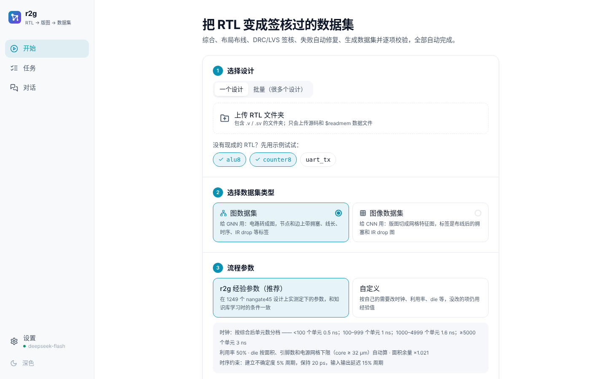
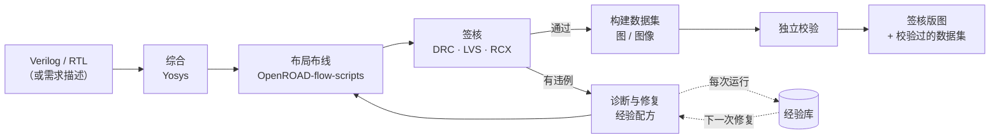
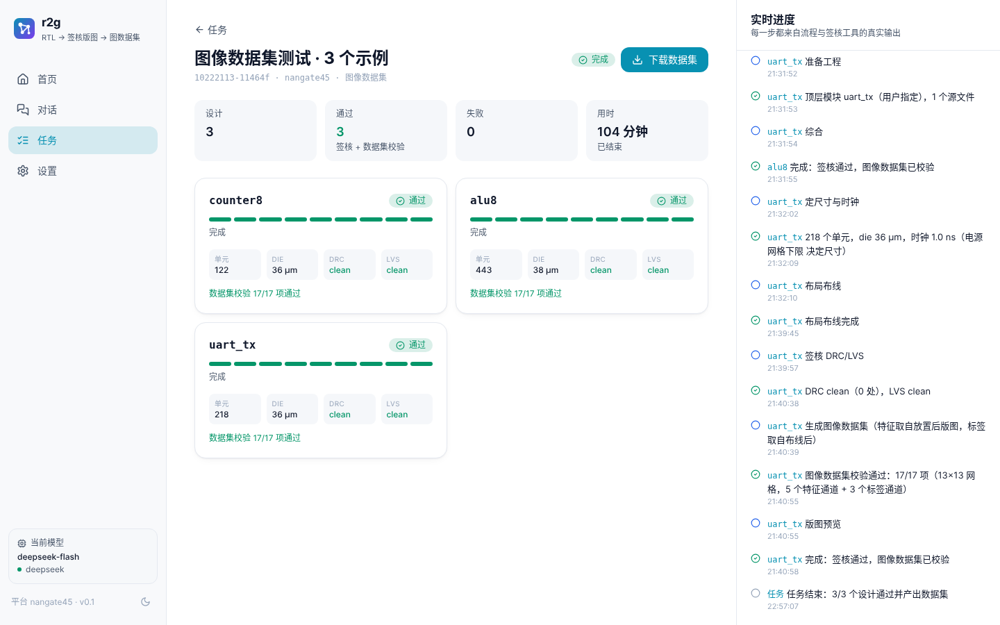
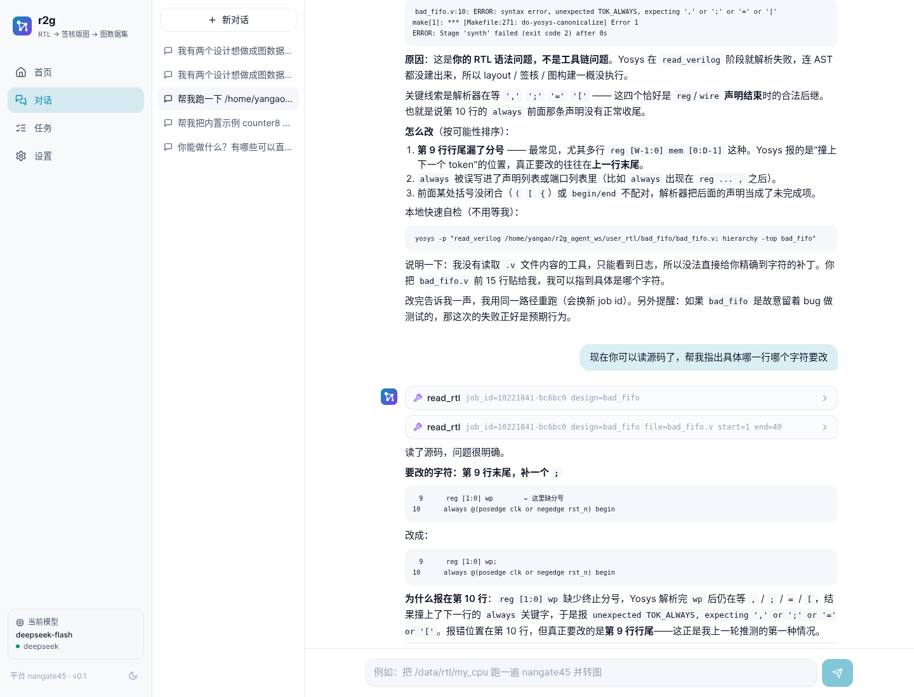
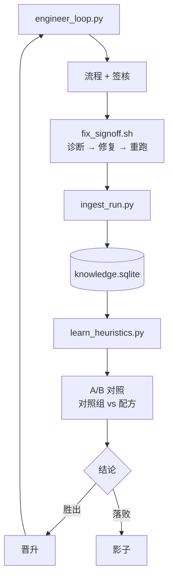

<div align="center">

# r2g

**从 RTL 到签核版图，再到可训练的数据集。**

基于 OpenROAD 的开源 EDA 自主 agent：综合、布局布线、DRC/LVS 签核、自动修复，
最后把你的 Verilog 变成经过独立校验的机器学习数据集。

[](LICENSE)


[English](README.md) · **简体中文**



</div>

---

## 目录

- [亮点](#亮点)
- [工作流程](#工作流程)
- [快速开始](#快速开始)
- [使用 r2g](#使用-r2g)
- [两种数据集](#两种数据集)
- [结论为什么可信](#结论为什么可信)
- [Codex 技能](#codex-技能)
- [平台支持](#平台支持)
- [验证情况](#验证情况)
- [仓库结构](#仓库结构)
- [文档](#文档)
- [许可证](#许可证)

## 亮点

| | |
|---|---|
| **端到端** | 输入 Verilog，自动完成综合、布图规划、布局、时钟树、布线、GDS、DRC、LVS、RCX。 |
| **自动修复** | 读日志、诊断失败、选用学到的修法、重跑并复核；每次运行都写入经验库，下一次修得更好。 |
| **可直接训练的数据集** | 签核通过的设计转成 PyTorch Geometric **图数据集**或 GCell **图像数据集**，逐项独立复核。 |
| **模型自选** | DeepSeek、通义千问、Kimi、智谱 GLM、豆包、OpenAI、Gemini、Claude 或本地 Ollama，配置一次即可使用。 |
| **三种用法** | 网页、命令行，或接入 Codex、Claude Code 等任意 MCP 客户端。 |

## 工作流程



模型决定**尝试什么**，代码判定**是否成功**。是否通过只由 DRC/LVS 检查器和数据集校验器决定；
模型能调用的工具里，没有一个能宣布“通过”。

## 快速开始

**需要：**
- 一台 x86_64 Linux 机器，glibc ≥ 2.35（Ubuntu 22.04+、Debian 12+ 等），无需 root 权限；
- 预装 Git、curl、CA 证书，以及带 `venv`/`ensurepip` 的 Python 3.10+；
- 约 80 GB 可用空间（三个平台加自检，含 50 GB 运行磁盘保护余量）；
- 能访问 GitHub、Conda 和 PyPI。

```bash
git clone https://github.com/ShenShan123/r2g-skills.git
cd r2g-skills
bash install.sh
```

安装器会依次：
1. 检查机器；
2. 安装固定版本的工具链（已有的会被识别并跳过）：
   - 生成全部 r2g 数据集所用的同一套 OpenROAD、Yosys、KLayout 预编译包，逐个校验 sha256；
   - 固定版本的 OpenROAD-flow-scripts；
   - 图数据集用的 PyTorch 环境；
   - 实验所用版本的 SKY130/GF180 PDK，核对包哈希；
3. 严格验证 nangate45、sky130hd、gf180；
4. 安装 agent，并把 `r2g` 放进 `~/.local/bin`；
5. 让你选择模型并填写 API 密钥（只保存在本机）；
6. 可选自检：在每个所选平台上把内置的 `counter8` 从 RTL 跑到数据集。

安装成功退出并不代表整个语料都能通过；是否执行了物理自检会单独打印。

<details>
<summary><b>安装参数</b></summary>

| 参数 | 作用 |
|---|---|
| `--yes` | 不逐项确认 |
| `--prefix DIR` | 大文件放在哪里 |
| `--platforms nangate45` | 只安装并验证这些平台（逗号分隔） |
| `--skip-toolchain` | 工具链已经就绪 |
| `--provider deepseek --key-env DEEPSEEK_API_KEY` | 非交互配置模型 |
| `--no-config --selftest` | 不需要模型密钥的完整流程验收 |

SystemVerilog 修复使用独立的实验版 Yosys + Slang（OSS CAD Suite 2025-03-29），安装器会下载、校验归档与二进制哈希并记录路径，
不会替换布局布线流程所用的 Yosys。完整说明：`bash install.sh --help`。
</details>

## 使用 r2g

**任务在装了 r2g 的那台机器上跑，浏览器只是查看和操作的窗口。** r2g 只能装在 Linux 上，
Windows / macOS 用户把它装在 Linux 服务器上，在自己电脑上用浏览器访问。

| 装在哪里 | 任务在哪里跑 | 怎么打开网页 |
|---|---|---|
| 自己的 Linux 电脑 | 本机 | `r2g ui`，浏览器打开 `http://127.0.0.1:8770` |
| 服务器（推荐） | 服务器 | 服务器上常驻 `r2g ui`，本机转发端口后打开（见下） |

<details>
<summary><b>在服务器上使用</b></summary>

1. 在服务器上启动服务并保持运行（tmux 或后台）：

   ```bash
   nohup r2g ui > ~/r2g_ui.log 2>&1 &      # 默认端口 8770；换端口：r2g ui --port 9000
   ```

2. 把端口转发到自己电脑，任选一种：
   - **VS Code 远程**：在「端口 / PORTS」面板转发 `8770`，点地球图标打开。
   - **SSH 隧道**（Windows PowerShell、macOS、Linux 通用）：

     ```bash
     ssh -N -L 8888:127.0.0.1:8770 用户名@服务器地址
     ```

     输入密码后窗口没有输出是正常的，保持打开，然后浏览器访问 `http://127.0.0.1:8888`。
     如果报 `bind [127.0.0.1]:8888: Permission denied`，说明本机端口被占用或保留，换一个（如 7070）；
     Windows 上可用 `netsh interface ipv4 show excludedportrange protocol=tcp` 查看保留端口。

说明：
- 服务只在服务器的 `127.0.0.1` 上监听，必须经 SSH 或 VS Code 转发访问。
- 关闭浏览器或断开隧道不影响任务；服务重启后，未完成的设计自动续跑。
- 每个用户的任务、设置、密钥和修复经验都在自己的 `~/.r2g/` 下。
- 同时跑几个设计、每个用几个核，在「设置 → 算力」里改；网页、命令行、对话共用这个上限。
</details>

### 网页的三个页面

| 开始 | 任务 | 对话 |
|---|---|---|
|  |  |  |
| 五步：选设计（一个文件夹，或批量：每个子文件夹一个设计，可上传或填服务器路径）→ 选平台 → 选数据集类型 → 流程参数（平台默认值，或自定义时钟、利用率、die）→ 开始。上传的文件夹会立即检查并显示顶层模块；有多个候选时由你选一个。不需要配置模型。 | 每个设计的进度（综合 → 布局布线 → 签核 → 修复 → 数据集 → 校验）、失败原因、修复记录、版图与日志、数据集下载；批量任务可按状态筛选、按失败原因归类，运行中也能下载已完成部分。可停止任务（先确认；会结束其 EDA 进程）、把失败或已取消的设计作为新任务重新运行，或连同生成的全部数据删除任务。任务列表可按状态筛选、按名称或编号搜索。 | 一句话提要求，例如“在 GitHub 上找个小的 UART 设计跑一遍”“/data/rtl 下的设计都跑，时钟用 2 ns”“这个任务失败的设计是什么原因”。回答可以中途停止；关掉页面也不会丢。需先在「设置」中配置模型。 |

### 命令行与其他客户端

```bash
r2g config --provider qwen --set-key     # 更换模型
r2g check-model                          # 测试模型连通与工具调用
r2g run --example counter8               # 不经过对话，直接运行
r2g status                               # 查看任务
r2g chat                                 # 在终端里对话
r2g mcp                                  # 作为 MCP 服务器，接入 Codex、Claude Code、Cursor 等
```

## 两种数据集

| | 图数据集 | 图像数据集 |
|---|---|---|
| **形式** | PyTorch Geometric `HeteroData`：五种视图（b–f）+ 网表图 | GCell 网格上的多通道数组（`.npz`，`[x][y]`）+ 预览图 |
| **特征** | 单元、线网、引脚的几何与电气特征 | 单元密度、宏单元区域、RUDY、引脚 RUDY、引脚密度，**只取自放置后的版图**，不含布线信息 |
| **标签** | 拥塞、线长、时序、IR drop、RC 寄生参数 | 拥塞、IR drop |
| **校验** | `tools/verify_graph_dataset.py`：数百项检查 | `verify_images.py`：17 项，含与图数据集拥塞标签的逐单元对齐 |

`def-graph` 技能还能构建**四阶段因果数据集**：同一设计在布图规划、布局、时钟树、布线四个阶段的快照，
有图和图像两种形式，每个阶段只使用该阶段合法可见的信息。详见
[`r2g-skills/def-graph/SKILL.md`](r2g-skills/def-graph/SKILL.md)。

## 结论为什么可信

- **模型负责判断，代码负责判定。** 是否通过只由 DRC/LVS 与数据集校验器决定；检查器崩溃或超时不算通过。
- **只收签核通过的设计。** 数据集构建前有签核门；版图与报告按内容摘要绑定，换了版图旧报告即失效。
- **每个数据集都独立复算。** 校验程序不复用生成代码，自行解析 DEF/LEF/SPEF 重新计算并比对。
- **失败分得清。** agent 区分“RTL 本身有问题”和“工具 / 流程问题”，并引用真实报错码。

设计文档：[`docs/agent/AGENT_DESIGN.md`](docs/agent/AGENT_DESIGN.md)。

## Codex 技能

agent 背后的引擎以四个标准 `SKILL.md` 格式的技能发布，已在 [OpenAI Codex](https://github.com/openai/codex)
（GPT）中测试通过，也可以直接使用：先对 Codex 说“装好 EDA 工具”，再说“在 nangate45 上把这个 UART 按 100 MHz 综合到 GDS”。

| 技能 | 作用 |
|---|---|
| [`eda-install`](r2g-skills/eda-install/SKILL.md) | 检测机器，安装并验证工具链（默认无需 sudo） |
| [`rtl-acquire`](r2g-skills/rtl-acquire/SKILL.md) | 大规模发现与筛选 RTL，生成仅综合的网表图，把候选一键提升为完整流程项目 |
| [`signoff-loop`](r2g-skills/signoff-loop/SKILL.md) | RTL → GDS 全流程签核，以及可自我改进的修复循环 |
| [`def-graph`](r2g-skills/def-graph/SKILL.md) | 从签核通过的 DEF/LEF/SPEF 构建 PyG 图数据集与图像数据集 |

```bash
bash r2g-skills/install.sh --codex --user          # 四个技能安装到 ~/.codex/skills/（或 $CODEX_HOME/skills/）
```

之后新开一个 Codex 会话即可（技能在会话开始时读取）。其他方式：`--project .`（安装到 `./.agents/skills/`，
仅限当前仓库）、`--link`（符号链接，修改无需重装）、`--force`（覆盖）、`--uninstall`（卸载）。这些技能同样
适用于 Claude Code：去掉 `--codex` 即安装到 `~/.claude/skills/`（配合 `--project` 时为 `./.claude/skills/`）。

流程会在 OpenROAD-flow-scripts 目录（`$ORFS_ROOT/flow`）中写入工作文件，而 Codex 默认沙箱只允许写工作区，
需要把该目录也设为可写：

```bash
codex --add-dir "$ORFS_ROOT/flow"          # 或在 ~/.codex/config.toml 的 sandbox_workspace_write.writable_roots 中加入
```

<details>
<summary><b>依赖</b></summary>

| 工具 | 必需 | 用途 |
|------|------|------|
| Python 3.10+ | 是 | 技能脚本 |
| Yosys | 是 | 综合 |
| iverilog / vvp | 是 | 仿真 |
| OpenROAD + ORFS | 是 | 布局布线、RCX |
| Verilator | 可选 | 更快的 lint |
| KLayout | 可选 | 版图查看、DRC、LVS |
| Magic + Netgen | 可选 | sky130 DRC / LVS |
| OpenSTA | 可选 | 独立时序分析 |
| sky130A PDK | 可选 | sky130 签核 |
| torch + torch_geometric + pandas | 可选 | PyG 图数据集（`run_graphs.sh`，`R2G_GRAPH_PYTHON`） |
</details>

<details>
<summary><b>配置工具链</b></summary>

技能首次使用时会自动探测所有工具；工具装在常见位置时不需要 `source` 或 `export`。
最快的方式是让 `eda-install` 自动检测并安装：

```bash
bash r2g-skills/bootstrap.sh --dry-run     # 检测工具、PDK、torch 环境，给出安装计划，不安装任何东西
```

没有 root 时它会自动选择**无需 sudo 的路径**：conda `litex-hub` 预编译包，加上放在大容量盘上的 torch 环境，
绝不放进已满的 `$HOME`。去掉 `--dry-run` 即安装缺失部分并生成 `references/env.local.sh`；
加 `--prefix /big/volume` 指定 PDK 和环境的位置。

**方式 A：共享 EDA 服务器。** 如存在 `/opt/openroad_tools_env.sh`，会自动加载。

**方式 B：从源码构建 ORFS**（8 核约 30 分钟）：

```bash
sudo apt install build-essential cmake git python3 python3-pip iverilog klayout tcl-dev libboost-dev flex bison
git clone --recursive https://github.com/The-OpenROAD-Project/OpenROAD-flow-scripts ~/OpenROAD-flow-scripts
cd ~/OpenROAD-flow-scripts && sudo ./etc/DependencyInstaller.sh && ./build_openroad.sh --local
echo 'export ORFS_ROOT="$HOME/OpenROAD-flow-scripts"' >> ~/.codex/skills/signoff-loop/references/env.local.sh
```

**方式 C：OSS CAD Suite 加单独的 OpenROAD：**

```bash
curl -LO https://github.com/YosysHQ/oss-cad-suite-build/releases/latest/download/oss-cad-suite-linux-x64.tgz
tar -xf oss-cad-suite-linux-x64.tgz -C "$HOME"
sudo apt install openroad
git clone --recursive https://github.com/The-OpenROAD-Project/OpenROAD-flow-scripts ~/OpenROAD-flow-scripts
```

然后在 `env.local.sh` 中设置路径：

```bash
export ORFS_ROOT="$HOME/OpenROAD-flow-scripts"
export YOSYS_EXE="$HOME/oss-cad-suite/bin/yosys"
export IVERILOG_EXE="$HOME/oss-cad-suite/bin/iverilog"
export VVP_EXE="$HOME/oss-cad-suite/bin/vvp"
export VERILATOR_EXE="$HOME/oss-cad-suite/bin/verilator"
export OPENROAD_EXE="/usr/bin/openroad"
export KLAYOUT_CMD="/usr/bin/klayout"
```

**`env.local.sh`**：位于 `~/.codex/skills/signoff-loop/references/env.local.sh`，从 `env.local.sh.template` 复制。
所有键都是可选的，只需填写自动探测出错的项。也可以放在任意位置，然后 `export R2G_ENV_FILE=/path/to/your-env.sh`。

| 变量 | 依次检查（第一个命中即用） |
|----------|-----------------------------------|
| `ORFS_ROOT` | `$HOME/OpenROAD-flow-scripts`、`/opt/OpenROAD-flow-scripts`、`/opt/EDA4AI/OpenROAD-flow-scripts`、技能目录旁 |
| `OPENROAD_EXE` | `$ORFS_ROOT/tools/install/OpenROAD/bin/openroad`、`/usr/local/bin/openroad`、`/usr/bin/openroad` |
| `YOSYS_EXE` | `$ORFS_ROOT/tools/install/yosys/bin/yosys`、`/opt/pdk_klayout_openroad/oss-cad-suite/bin/yosys`、`/usr/local/bin/yosys`、`/usr/bin/yosys` |
| `IVERILOG_EXE` / `VVP_EXE` | `/opt/pdk_klayout_openroad/oss-cad-suite/bin/…`、`/usr/bin/…` |
| `KLAYOUT_CMD` | `/usr/local/bin/klayout`、`/usr/bin/klayout` |
| `MAGIC_EXE` | `/usr/local/bin/magic`、`/usr/bin/magic` |
| `NETGEN_EXE` | `$PATH` 中的 `netgen-lvs` 或 `netgen`、`/usr/bin/netgen-lvs`、`/usr/local/bin/netgen` |
| `STA_EXE` | `$PATH` 中的 `sta` 或 `opensta`、`/usr/local/bin/opensta`、`/usr/bin/opensta` |
| `PDK_ROOT` | `/opt/pdks`、`$HOME/pdks`、`/usr/local/share/pdks` |

**无 sudo 安装签核工具（Miniconda）：**

```bash
curl -sL -o /tmp/miniconda.sh https://repo.anaconda.com/miniconda/Miniconda3-latest-Linux-x86_64.sh
bash /tmp/miniconda.sh -b -p "$HOME/miniconda3"
# --override-channels：conda 的 defaults 频道需要交互式接受服务条款
"$HOME/miniconda3/bin/conda" create -y -n eda --override-channels -c litex-hub -c conda-forge magic netgen iverilog
"$HOME/miniconda3/bin/conda" install -y -n eda --override-channels -c litex-hub -c conda-forge open_pdks.sky130a  # 约 8 GB
```

然后把 `IVERILOG_EXE`、`VVP_EXE`、`MAGIC_EXE`、`NETGEN_EXE`、`PDK_ROOT` 指向
`$HOME/miniconda3/envs/eda/{bin,share/pdk}`。在 SOCKS 代理后面不要用 `volare`：它需要 `socksio`，
而且未认证的 GitHub 列表请求会被限流。

**验证配置：**

```bash
bash ~/.codex/skills/signoff-loop/scripts/flow/check_env.sh
```

运行流程前，所有**必需**项都必须显示 `ok`；可选项显示 `skip` 不影响。nangate45 只需必需工具加 KLayout。

| 现象 | 解决 |
|---------|-----|
| `MISS ORFS_ROOT` | 在 `env.local.sh` 中设置 `ORFS_ROOT` |
| `MISS OPENROAD_EXE` / `MISS YOSYS_EXE` | 设置路径，或先运行 `build_openroad.sh --local` |
| `MISS IVERILOG_EXE` | `sudo apt install iverilog`，或设置 `IVERILOG_EXE` |
| 平台列表为空 | 设置了 `ORFS_ROOT` 但缺少 `flow/platforms/`，检查 ORFS 是否完整克隆 |
</details>

<details>
<summary><b>不通过 agent，直接使用脚本</b></summary>

```bash
SKILL=~/.codex/skills/signoff-loop
PROJ=design_cases/my_counter

python3 $SKILL/scripts/project/init_project.py my_counter          # 生成项目骨架
cp my_counter.v $PROJ/rtl/design.v; cp tb_counter.v $PROJ/tb/testbench.v
cp $SKILL/assets/config-template.mk $PROJ/constraints/config.mk
cp $SKILL/assets/constraint-template.sdc $PROJ/constraints/constraint.sdc   # 修改 DESIGN_NAME、VERILOG_FILES、时钟端口

bash $SKILL/scripts/flow/run_lint.sh  $PROJ/rtl/design.v $PROJ/lint/lint.log            # 前端
bash $SKILL/scripts/flow/run_sim.sh   $PROJ/rtl/design.v $PROJ/tb/testbench.v $PROJ/sim
bash $SKILL/scripts/flow/run_synth.sh $PROJ/rtl/design.v my_counter $PROJ/synth

bash $SKILL/scripts/flow/run_orfs.sh $PROJ nangate45                                    # 布局布线 → GDS

python3 $SKILL/scripts/extract/extract_ppa.py  $PROJ $PROJ/reports/ppa.json            # 时序门
python3 $SKILL/scripts/reports/check_timing.py $PROJ
python3 $SKILL/scripts/reports/fmax_search.py  $PROJ nangate45                          # 可选：Fmax 搜索

bash $SKILL/scripts/flow/run_drc.sh $PROJ nangate45                                     # 签核
bash $SKILL/scripts/flow/run_lvs.sh $PROJ nangate45
bash $SKILL/scripts/flow/run_rcx.sh $PROJ nangate45

R2G_GRAPH_PYTHON=/path/to/venv/bin/python \
bash ~/.codex/skills/def-graph/scripts/flow/run_graphs.sh $PROJ nangate45              # 数据集
# -> dataset/{b..f}_graph.pt（HeteroData；R2G_GRAPH_KIND=homo|both）、netlist_graph.pt、graph_manifest.json
```

完整示例见 `r2g-skills/signoff-loop/assets/examples/simple-arbiter/`。

| 阶段 | 脚本 | 输出 |
|-------|--------|--------|
| 规范化 / 初始化 | `scripts/project/{normalize_spec,init_project}.py` | `input/normalized-spec.yaml`、项目骨架 |
| Lint / 仿真 / 综合 | `scripts/flow/run_{lint,sim,synth}.sh` | `lint/` `sim/` `synth/` |
| 布局布线 | `scripts/flow/run_orfs.sh` | `backend/RUN_*/results/6_final.{gds,odb}` |
| 布线中止检查 | `scripts/extract/extract_route.py` | `reports/route.json` |
| 签核 | `scripts/flow/run_{drc,lvs,rcx}.sh` | `reports/{drc,lvs,rcx}.json` |
| PPA / 时序门 | `extract_ppa.py`、`check_timing.py` | `reports/ppa.json`；通过 / 小修 / 上报 |
| 签核修复 | `scripts/flow/fix_signoff.sh` | `reports/fix_log.jsonl` |
| 标签 / 特征 / 图 | `def-graph/scripts/flow/run_{labels,features,graphs}.sh` | `labels/`、`features/`、`dataset/` |

每个签核检查器都在有界的进程组监管下运行（`_bounded_run.sh`），卡死的工具不会比脚本活得更久。
每个阶段的产物都按摘要记录，续跑时只复用字节与父摘要一致的阶段；数据集签核门在发布前会重新核验这条链。
</details>

<details>
<summary><b>批量模式</b></summary>

`tools/` 可并行驱动数百个设计。它不随技能安装，需要克隆整个仓库使用。

```bash
python3 tools/setup_rtl_designs.py                       # 按 RTL 目录生成 design_cases/
bash tools/batch_orfs_only.sh 8 7200                     # 对所有项目跑 ORFS：8 路并行，每阶段 2 小时超时
python3 tools/fix_orfs_failures.py                       # 归类失败并改写 config.mk
DESIGNS_LIST=failed.txt bash tools/batch_orfs_only.sh 8 7200   # 重试
```

`fix_orfs_failures.py` 处理六类失败：
- 顶层模块错误；
- `SYNTH_MEMORY_MAX_BITS` 溢出；
- IO 引脚过多；
- 布局密度溢出；
- PDN 条宽；
- 阶段超时。

它的结构门会给设计做指纹，拒绝把设计“掏空”的 RTL 修改；退出码即结论：0 = 结构保持，2 = 拒绝，3 = 标记，1 = 错误。
</details>

<details>
<summary><b>闭环学习</b></summary>

每次运行都在教会技能。两个记忆数据库各司其职：

| 数据库 | 作用 | 纳入 git |
|---|---|---|
| `knowledge/knowledge.sqlite` | 结果：运行、失败事件、违例、修复轨迹、症状、经验、A/B 试验、配方状态 | **是**，随仓库发布预训练内容 |
| `knowledge/journal.sqlite` | 做了什么、为什么：每个动作、日志摘要、工具缺陷 | 否；仅本地取证，任何学习器都不读 |

`scripts/loop/engineer_loop.py` 无人值守地驱动整个循环：流程 → 签核修复 → 入库 → 学习 → A/B 试验 →
晋升或降级 → 未知问题上报。配方只有在 *k* 次重复、考虑方差的 A/B 对比中胜出，才会经
`shadow → candidate → promoted` 晋升；结论不确定时绝不降级。修复经验按症状签名而非平台存储，
所以在 nangate45 上学到的修法可以迁移到 sky130hd。



详见 [`signoff-loop/knowledge/README.md`](r2g-skills/signoff-loop/knowledge/README.md) 与
[`references/engineer-loop.md`](r2g-skills/signoff-loop/references/engineer-loop.md)。
</details>

## 平台支持

| 平台 | KLayout DRC | KLayout LVS | Magic DRC | Netgen LVS | OpenRCX | agent / 网页 |
|---|:---:|:---:|:---:|:---:|:---:|:---:|
| `nangate45` | ✓ | ✓ | — | — | ✓ | ✓ |
| `sky130hd` | ✓ | ✓ | ✓ | ✓ | ✓ | ✓ |
| `sky130hs` | ✓ | ✓ | ✓ | ✓ | ✓ | — |
| `gf180` | ✓ | ✓ | — | — | ✓ | ✓ |
| `ihp-sg13g2` | ✓ | ✓ | — | — | ✓ | — |

- **SKY130**：以 Netgen LVS 为正式路径；天线二极管设计与端口直通由流程自动处理或通过阶段钩子处理。
- **没有 LVS 规则的平台**：LVS 报告 `skipped`，不算失败。
- **ASAP7**：当前版本不支持（`run_orfs.sh` 会拒绝），因为没有开源规则能得到干净结论。如仍想试验可设置
  `R2G_ALLOW_UNSUPPORTED_PLATFORM=1`，结果不具备签核质量。

## 验证情况

- **测试**：四个技能共收集 2,725 项测试（截至 2026-11-20）：signoff-loop 1,624、def-graph 669、
  rtl-acquire 367、eda-install 65。其中包括驱动真实提取器的合成边界用例，用手工推导的真值核对全部五种图视图。
  每一项校验都经过负对照，证明它在故意破坏的数据上会报错。
- **nangate45 语料（682 个设计，2026-06）**：
  - ORFS 布局布线：原始批次 495 个设计中 476 个通过；
  - LVS：674 个中 607 个通过（90%），其余多为已知工具限制而非版图错误；
  - DRC：682 个中 675 个得到可靠结论；
  - RCX：682 个中 681 个通过；
  - 精选的 70 个设计子集 100% 通过。
- **sky130hd 批量（2026-06）**：
  - 前 176 个设计中 174 个完整签核；
  - `route_relief` 解决了 25 个布线拥塞失败中的 18 个。

## 仓库结构

```
r2g-skills/
├── install.sh            # agent 与工具链的一键安装器
├── agent/                # r2g agent：命令行、网页服务、MCP 服务、模型适配
├── webui/                # 网页前端源码（构建到 agent/r2g_agent/web/dist）
├── r2g-skills/           # 四个 agent 技能（安装到 ~/.codex/skills/ 或 ~/.claude/skills/）
│   ├── eda-install/      #   检测 → 安装 → 验证工具链
│   ├── rtl-acquire/      #   大规模 RTL 获取与仅综合网表图
│   ├── signoff-loop/     #   RTL → GDS、签核、修复循环与经验库
│   └── def-graph/        #   从签核版图构建图与图像数据集
├── tools/                # 批量编排与独立数据集校验器
├── docs/                 # agent 设计说明与截图
└── tests/                # 仓库级测试
```

## 文档

| 主题 | 位置 |
|---|---|
| agent 设计 | [`docs/agent/AGENT_DESIGN.md`](docs/agent/AGENT_DESIGN.md) |
| 流程、签核与修复 | [`r2g-skills/signoff-loop/SKILL.md`](r2g-skills/signoff-loop/SKILL.md) |
| 已知失败与修法 | [`signoff-loop/references/failure-patterns.md`](r2g-skills/signoff-loop/references/failure-patterns.md) |
| 各平台检查内容 | [`signoff-loop/references/signoff-contract.md`](r2g-skills/signoff-loop/references/signoff-contract.md) |
| 数据集：视图、张量、标签 | [`def-graph/references/graph-dataset.md`](r2g-skills/def-graph/references/graph-dataset.md) |
| 四阶段数据集 | [`def-graph/references/four-stage-dataset.md`](r2g-skills/def-graph/references/four-stage-dataset.md) |
| 更新记录 | [`CHANGELOG.md`](CHANGELOG.md) |

## 许可证

[MIT](LICENSE) © 2026 Shenshan
